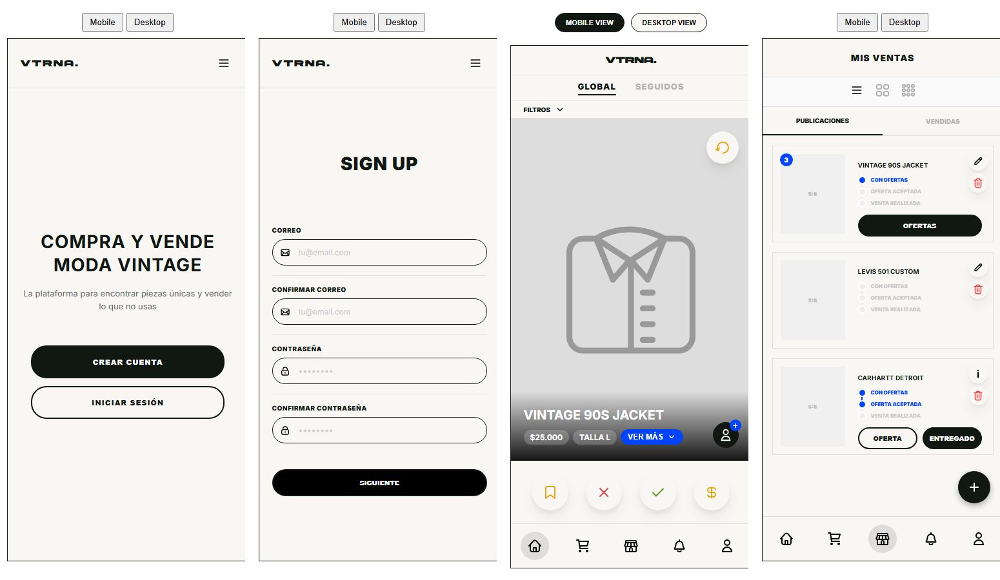

# VTRNA: mockups de marketplace de moda vintage

Prototipos HTML/CSS/JS de la interfaz de **VTRNA**, una plataforma para comprar y vender ropa vintage, diseñados para el curso IIC3143 (Desarrollo de Software, PUC Chile). Sirvieron para validar los flujos de usuario antes de implementar el frontend del proyecto.



## Pantallas

| Vista | Descripción |
|---|---|
| `views/landing` | Página de inicio con llamados a registrarse o iniciar sesión |
| `views/sign-up`, `views/login` | Registro en pasos e inicio de sesión |
| `views/preferences` | Preferencias de estilo, talla, marcas y metro más cercano |
| `views/swipe` | Descubrimiento de prendas con gestos tipo swipe (guardar, descartar, aceptar, ofertar) y pestañas Global / Seguidos |
| `views/mis-ventas` | Gestión de publicaciones: estados de oferta y venta, edición y alta de prendas |
| `views/mis-compras` | Seguimiento de compras |

Cada vista tiene modo **móvil** y **escritorio** (botones en la parte superior de la página).

## Stack

HTML, CSS y JavaScript sin dependencias ni build. Íconos SVG en `assets/`; tipografías desde Google Fonts y Adobe Fonts.

## Cómo verlo

Abrir cualquier `views/<vista>/<vista>.htm` en el navegador. Para las vistas que cargan `metro-stations.json` (`mis-ventas`, `preferences`) conviene servir la carpeta:

```bash
python -m http.server 8000
# luego abrir http://localhost:8000/views/swipe/swipe.htm
```
